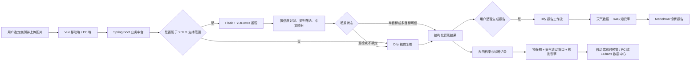

<div align="center">


# 基于多模型协同的农作物病虫害智能识别与预测 LeafQuery

**从拍照识别到可解释预警的农作物病虫害智能服务平台**

[](https://openjdk.org/)
[](https://spring.io/projects/spring-boot)
[](https://vuejs.org/)
[](https://docs.ultralytics.com/)
[](https://www.mysql.com/)
[](https://dify.ai/)

</div>

## 项目简介

LeafQuery 面向种植户、农技人员与平台运营人员，将图像识别、大模型复核、知识检索、天气特征和农田档案组织为一条完整业务链路。项目不止返回一个病虫害名称，而是继续提供诊断报告、连续问答、语音交互、历史记录和未来风险趋势。

核心闭环为：

> 拍照识别 -> 条件复核 -> 深度报告 -> 农田归档 -> 趋势预警 -> 知识与社区服务

## 系统架构



## 核心功能

| 模块 | 主要能力 |
| --- | --- |
| 分层图像识别 | 用户先选作物或虫害类别，Java 判断路由，Python 执行 YOLOv8s 检测、置信度过滤、类别筛选和中英文映射 |
| 大模型复核 | 训练集外类别、空检和低置信度结果自动进入 Dify 视觉复核；可信单目标和多目标结果直接返回 |
| 深度诊断报告 | 用户按需触发报告工作流，融合识别结果、复核结论、地区天气和 RAG 知识检索生成 Markdown 报告 |
| 趋势预测 | 使用物候期、温度、湿度、降雨、连续雨日、月份和风速构造七日可解释风险序列 |
| 自动物候判断 | 结合播种或移栽日期、六大农业生态区和区域日历估算物候期，并保留用户手动确认优先级 |
| 语音与连续问答 | 支持语音转文字、报告转语音及携带诊断上下文的连续追问 |
| 农田档案与记录 | 游客数据保存在当前浏览器；登录后同步农田档案、激活作物、诊断记录和收藏数据到 MySQL |
| 知识与社区 | 提供知识库、资讯、问答、评论、点赞、收藏、专家点评和通知功能 |
| 多端可视化 | 移动端面向单作物即时决策；PC 数据中心使用 ECharts 展示识别趋势、对象分布、置信度和多目标风险对比 |
| 运营后台 | 管理用户、管理员、公告、资讯、知识条目、社区内容、部分模型配置和操作日志 |

## 识别与复核规则

YOLO 输出的类别编号先由 Python 转换为训练类别中的英文名称，再通过 [类别元数据配置](docs/detection_target_metadata_clean.json) 映射为中文业务名称。Java 与 Python 共同读取这份 JSON 配置，以避免两端分别维护类别列表。

当前识别门控逻辑如下：

| 判断 | 当前默认值 | 作用 |
| --- | ---: | --- |
| 检测框候选阈值 | `0.35` | 低于该值的检测框不进入候选集合 |
| 主目标可信阈值 | `0.60` | 主目标低于该值时标记为不确定并触发复核 |
| `empty` | 无原始检测框 | 自动进入 Dify 复核 |
| `uncertain` | 检测框均被过滤，或主目标低于 `0.60` | 自动进入 Dify 复核 |
| `single` | 一个保留类别且主目标达到 `0.60` | 直接返回识别结果 |
| `multi` | 多个保留类别且主目标达到 `0.60` | 保留完整摘要并直接返回 |

超过 `1 MB` 的上传图片会由 Java 使用 ImageIO 重绘：最长边按比例缩小至 `1024` 像素、透明背景铺白，并统一保存为 JPG，以降低视觉模型传输与存储负担。

> `0.35` 和 `0.60` 是当前工程门控参数，不代表经过完整阈值扫描得到的全局最优值，后续需要通过独立验证集和真实反馈继续标定。

## 趋势预测范围

趋势预测与图像识别不是同一个类别范围。当前规则引擎只为 **3 种作物、12 个目标** 配置了独立参数：

| 作物 | 病害 | 虫害 |
| --- | --- | --- |
| 冬小麦 | 白粉病、条锈病 | 麦蚜、吸浆虫 |
| 水稻 | 稻瘟病、纹枯病 | 稻飞虱、稻纵卷叶螟 |
| 玉米 | 大斑病、锈病 | 玉米螟、蚜虫 |

病害和虫害采用不同的加权公式：

```text
病害风险 = 30% × 物候风险 + 25% × 湿度风险 + 25% × 降雨风险 + 20% × 温度风险

虫害风险 = 25% × 温度风险 + 20% × 物候风险 + 20% × 月份风险
         + 20% × 风速风险 + 15% × 降雨风险
```

天气服务提供历史、当天和未来天气，后端负责计算近三日平均温湿度、近七日累计降雨和连续降雨天数，并逐日推进滚动窗口。输出包括当天风险、七日序列、风险等级、趋势方向及贡献最高的三个驱动因素。

> 风险分数是环境条件与农业规则形成的相对风险指数，不是病虫害必然发生的概率，也不能替代田间调查和农技人员判断。

## 技术栈

| 层级 | 技术 |
| --- | --- |
| 用户端 | Vue 3、Vite、Pinia、Vue Router、Tailwind CSS、ECharts、Capacitor |
| 管理端 | Vue 3、Vite、Pinia、Vue Router |
| 业务后端 | Java 17、Spring Boot 3.5、MyBatis、MySQL |
| 视觉推理 | Python、Flask、Ultralytics YOLOv8s、Pillow |
| AI 编排 | Dify 工作流、视觉复核、RAG 报告生成 |
| 外部能力 | 和风天气 JWT 鉴权接口、豆包大模型、Seed ASR、Seed TTS |
| 数据状态 | MySQL 云端持久化、Pinia 运行时状态、localStorage 游客兜底 |

## 项目结构

```text
leafquery/
├── src/main/java/com/example/leafquery/  # Spring Boot 控制器、服务、实体与 Mapper
├── src/main/resources/                   # 配置、SQL、MyBatis 映射
├── python_service/                       # Flask + YOLO 推理服务及 best.pt
├── vue-frontend/                         # 移动端与 PC 用户端
├── admin-frontend/                       # 独立运营管理后台
├── docs/                                 # 类别配置与项目资料
├── .env.example                          # 本机环境变量模板
├── .env.production.example               # 服务器环境变量模板
├── start-all.cmd                         # Windows 一键启动入口
├── start-all.ps1                         # 环境读取、启停及检查
├── pom.xml                               # Java/Maven 依赖
└── README.md
```

## 本地开发（Windows）

本节用于在自己电脑上运行和调试；服务器部署见后面的“服务器部署”。下列命令除特别说明外，都在应用仓库 `leafquery/` 根目录执行。

### 环境要求

- JDK 17+，配置 `JAVA_HOME`
- MySQL 8.x
- Node.js 20.19+ 或 22.12+（两个前端使用 Vite 7）
- Python 3.10（推荐）

### 1. 克隆仓库

```bash
git clone https://github.com/chenhongyuan1/leafquery.git
cd leafquery
```

### 2. 准备数据库

已有可用的 `leafquery` 数据库时直接使用，跳过初始化。只有新的空数据库才需要先建库，再导入 `src/main/resources/schema.sql`。以下为 Bash 示例；Windows 可在 SQLyog 中先创建数据库，再导入 SQL 文件：

```bash
mysql -u root -p -e "CREATE DATABASE leafquery CHARACTER SET utf8mb4;"
mysql -u root -p leafquery < src/main/resources/schema.sql
```

> `schema.sql` 包含删除并重建表的语句，只应对新的开发数据库执行，不要直接用于已有生产数据。

### 3. 配置环境变量

在应用仓库根目录准备本地配置：

```powershell
if (-not (Test-Path .env)) { Copy-Item .env.example .env }
```

编辑 `.env` 中的本机数据库账号、密码及需要的第三方接口凭据。已有 `.env` 时直接编辑，避免覆盖。`.env` 和 `.env.production` 已被 Git 忽略；`.env.example`、`.env.production.example` 作为不含真实密码或密钥的模板提交。

仓库根目录的 `start-all.cmd` 会显式读取同目录 `.env`，然后启动 Python、Java、用户端和管理端。已设置的进程环境变量优先于 `.env`；文件中的值不会作为命令执行，也不会进行变量展开。带空格或 `#` 的值请加引号，双引号中支持 `\\`、`\"`、`\n`、`\r`、`\t` 转义。后端密钥不能使用 `VITE_` 前缀，否则可能进入前端构建产物。

Spring Boot 本身不会自动读取 `.env`。下文直接用 Maven 或 IDE 启动时，需要将同样的变量注入进程环境。

`application.properties` 保存公共配置和变量引用，默认使用 `dev`，叠加 `application-dev.properties`；设置 `SPRING_PROFILES_ACTIVE=prod` 才会叠加 `application-prod.properties`。这些文件不含真实凭据，应保留在 Git 中。可选的 `application-local.properties` 和 `application-*.local.properties` 属于个人配置，已忽略；`.gitignore` 不会清除已有 Git 历史中的凭据。

服务器部署参考 `.env.production.example`，由部署平台或进程管理器注入变量，并设置 `SPRING_PROFILES_ACTIVE=prod`。仅将文件命名为 `.env.production` 不会让 Spring 自动加载它；Windows 启动器用于本地开发，会拒绝 `prod`。

本地一键启动时的配置顺序是：`start-all.cmd` → `start-all.ps1` 读取 `.env` → 把变量传给后端 → 读取公共 `application.properties` 并叠加 `application-dev.properties` → 用变量值连接数据库。同名进程环境变量优先于 `.env`；环境配置中的同名属性覆盖公共配置；`${变量名:默认值}` 表示没有提供变量时使用默认值。

| 文件（相对于应用仓库） | 用途 | 自动读取方式 |
| --- | --- | --- |
| `.env` | 本机实际账号、密码、密钥，不提交 Git | 本地启动器读取 |
| `.env.example` | 本机配置模板，可提交 Git | 不读取，复制为 `.env` 后填写 |
| `.env.production` | 服务器实际配置，不提交 Git | 由部署平台或下面的 systemd 示例加载 |
| `.env.production.example` | 服务器配置模板，可提交 Git | 不读取，复制后填写 |
| `vue-frontend/.env.production` | 用户端正式打包时的公开参数 | 用户端执行 `npm run build` 时由 Vite 读取 |
| `admin-frontend/.env.production` | 管理端正式打包时的公开参数 | 管理端执行 `npm run build` 时由 Vite 读取 |

后端的开发模式叫 `dev`，生产模式叫 `prod`；前端 Vite 的对应模式叫 `development` 和 `production`。两端独立选择环境，文件存在本身不会切换后端环境。

完整功能涉及以下变量：

| 变量 | 用途 |
| --- | --- |
| `SPRING_PROFILES_ACTIVE` | 本地 `dev`，服务器 `prod` |
| `DB_URL`、`DB_USERNAME`、`DB_PASSWORD` | MySQL 连接 |
| `PYTHON_AI_URL` | Python `/predict` 服务地址 |
| `DETECTION_METADATA_PATH` | 类别元数据 JSON 路径 |
| `UPLOAD_DIR` | 本地图片存储目录 |
| `YOLO_DETECTION_BOX_THRESHOLD` | 检测框候选阈值 |
| `YOLO_DETECTION_PRIMARY_THRESHOLD` | 主目标可信阈值 |
| `DIFY_API_URL`、`DIFY_API_KEY` | Dify 工作流 |
| `DOUBAO_API_URL`、`DOUBAO_API_KEY`、`DOUBAO_API_MODEL` | 连续问答模型 |
| `QWEATHER_API_HOST`、`QWEATHER_PROJECT_ID`、`QWEATHER_KEY_ID`、`QWEATHER_PRIVATE_KEY` | 和风天气 JWT 鉴权 |
| `ASR_APP_ID`、`ASR_ACCESS_TOKEN`、`ASR_RESOURCE_ID` | 语音识别 |
| `TTS_APP_ID`、`TTS_ACCESS_TOKEN`、`TTS_RESOURCE_ID`、`TTS_SPEAKER` | 语音合成 |

### 4. 一键启动（推荐）

在应用仓库根目录执行：

```powershell
.\start-all.cmd check             # 检查 JDK、Node、Python、依赖和数据库端口
.\start-all.cmd                   # 启动四个服务并打开两个前端
.\start-all.cmd status            # 查看状态
.\start-all.cmd restart-backend   # 修改 .env 后重新读取并重启后端
.\start-all.cmd stop              # 停止启动器管理的服务，保留 MySQL
```

四个服务地址分别为：用户端 `http://localhost:5173`、管理端 `http://localhost:5174`、Java `http://localhost:8080`、Python `http://localhost:5000`。日志位于仓库根目录的 `.leafquery-runtime/logs/`。旧版本若没有启动文件，可使用下面的手动启动方式。

预检只确认 MySQL 端口可连接；启动成功后，还会请求数据库资讯接口检查实际业务连接。启动器不会导入 SQL 或重建表。重复 `start` 不会刷新已运行服务的配置，修改后端参数后使用 `restart-backend`。

### 5. 手动启动（IDE 或没有启动器时）

分别打开终端运行以下服务。先在 IDE / 终端中注入上表需要的环境变量；下面的 Maven、Python 命令不会自动读取仓库 `.env`。后端不指定环境时默认用 `dev`。这台 Windows 电脑若出现 Java 本地通道错误，可把后端进程的 `TEMP`、`TMP` 指向项目内可写且不含中文的临时目录。

#### Python 推理服务

```powershell
cd python_service
python -m venv .venv
.\.venv\Scripts\Activate.ps1
pip install -r requirements.txt
python app.py
```

默认地址：`http://localhost:5000`。

#### Java 后端

在仓库根目录执行：

```powershell
.\mvnw.cmd spring-boot:run
```

默认地址：`http://localhost:8080`。

#### 用户端

```powershell
cd vue-frontend
npm ci
npm run dev -- --port 5173 --strictPort
```

默认地址：`http://localhost:5173`。

#### 管理端

```powershell
cd admin-frontend
npm ci
npm run dev -- --port 5174 --strictPort
```

默认地址：`http://localhost:5174`。

## 服务器部署（Linux 示例）

以下以应用仓库位于 `/opt/leafquery`、上传目录为 `/srv/leafquery/uploads` 为例。实际域名、路径、数据库及证书需替换；本节提供配置和命令示例，尚未在目标服务器实测。数据库采用现有库或单独初始化的新库，正式发布前还需处理下文“当前边界”列出的权限、密码存储与接口鉴权问题。

部署关系为：浏览器 → Nginx（两个前端静态文件、`/api/` 转发、图片访问）→ Java → MySQL / Python。Java 和 Python 在同一服务器时，使用本机内部端口 `8080` 和 `5000`。

### 1. 准备生产参数

在服务器安装 JDK 17+、Python 3.10、Nginx；打包前端的机器还需安装上述版本的 Node.js。创建运行服务的系统账号 `leafquery`，确保它能读取项目并写入上传目录和 Python 的模型、缓存、备份目录，Nginx 能读取两个前端的 `dist/` 和上传图片。

```bash
cd /opt/leafquery
# 已有 .env.production 时直接编辑，保留实际配置。
if [ ! -f .env.production ]; then cp .env.production.example .env.production; fi
chmod 600 .env.production
```

编辑 `.env.production`，填写服务器实际值，至少确认：

| 变量 | 服务器设置 |
| --- | --- |
| `SPRING_PROFILES_ACTIVE` | `prod` |
| `DB_URL` | 服务器数据库的 JDBC 地址；按数据库提供商配置 TLS 和证书 |
| `DB_USERNAME`、`DB_PASSWORD` | 服务器专用数据库账号和密码 |
| `UPLOAD_DIR` | `/srv/leafquery/uploads`，作为持久化目录保留 |
| `PYTHON_AI_URL` | 本例为 `http://127.0.0.1:5000/predict` |
| `DETECTION_METADATA_PATH` | `/opt/leafquery/docs/detection_target_metadata_clean.json` |
| `SERVER_ADDRESS`、`SERVER_PORT` | 本例为 `127.0.0.1`、`8080` |

Dify、豆包、天气和语音变量按实际启用的功能填写。使用 UTF-8 无 BOM 保存环境文件，每行写 `变量名=值`；密钥可用引号包住，天气私钥使用单行 Base64。systemd 的环境文件解析规则与本地启动器不同，勿直接套用本地的 `\n` 转义格式。

### 2. 打包 Java，准备 Python

```bash
cd /opt/leafquery
chmod +x mvnw
./mvnw clean package

cd python_service
python3.10 -m venv .venv
.venv/bin/python -m pip install -r requirements.txt
.venv/bin/python -m pip install gunicorn
```

Maven 打包会执行测试，需要测试进程可用的数据库配置。测试用开发数据库应与正式数据库分开，打包进程也不会自动加载 `.env`。成功后生成 `target/leafquery-0.0.1-SNAPSHOT.jar`。可在构建机器完成打包，再把 JAR、Python 服务、`best.pt` 和类别元数据一起部署。

当前 `requirements.txt` 固定 `ultralytics==8.0.0`，本机已验证环境使用 `8.4.14`；新服务器需单独验证依赖和权重兼容性。本例采用 [Gunicorn 的 `模块:应用对象` 启动方式](https://gunicorn.org/run/)，从 `python_service/` 工作目录加载 `app:app`，先使用一个 worker 避免重复加载模型。

### 3. 用 systemd 加载参数并管理服务

将以下示例分别保存为 `/etc/systemd/system/leafquery-python.service` 和 `/etc/systemd/system/leafquery-backend.service`。systemd 会通过 [`EnvironmentFile` 读取变量并传给进程](https://github.com/systemd/systemd/blob/main/man/systemd.exec.xml)，后端才会获得 `.env.production` 中的值；仅复制文件不会生效。

```ini
# leafquery-python.service
[Unit]
Description=LeafQuery Python inference
After=network.target

[Service]
User=leafquery
WorkingDirectory=/opt/leafquery/python_service
Environment=DETECTION_METADATA_PATH=/opt/leafquery/docs/detection_target_metadata_clean.json
ExecStart=/opt/leafquery/python_service/.venv/bin/gunicorn --bind 127.0.0.1:5000 --workers 1 --timeout 180 app:app
Restart=on-failure

[Install]
WantedBy=multi-user.target
```

```ini
# leafquery-backend.service
[Unit]
Description=LeafQuery Java backend
After=network.target leafquery-python.service
Wants=leafquery-python.service

[Service]
User=leafquery
WorkingDirectory=/opt/leafquery
EnvironmentFile=/opt/leafquery/.env.production
ExecStart=/usr/bin/java -jar /opt/leafquery/target/leafquery-0.0.1-SNAPSHOT.jar
Restart=on-failure

[Install]
WantedBy=multi-user.target
```

上述账号、Java 路径和目录需与服务器一致；如果项目升级改变 JAR 名称，也需同步修改。Python 模型上传接口当前由管理后端固定调用 `localhost:5000`，因此本例将 Java 与 Python 放在同一服务器。拆分服务器前还需修改该接口地址，不能只改 `PYTHON_AI_URL`。

```bash
sudo systemctl daemon-reload
sudo systemctl enable --now leafquery-python leafquery-backend
sudo systemctl status leafquery-python leafquery-backend
```

修改 `.env.production` 后执行 `sudo systemctl restart leafquery-backend`。只有修改 service 文件时才需要再次 `daemon-reload`。通过部署平台运行时，在平台填写同样的环境变量、工作目录和启动命令即可。

### 4. 打包两个前端

编辑各自目录中的 `.env.production`，下面使用两个示例域名，均不带末尾 `/` 或 `/api`：

```dotenv
# vue-frontend/.env.production
VITE_API_BASE_URL=https://app.example.com
```

```dotenv
# admin-frontend/.env.production
VITE_API_BASE_URL=https://admin.example.com
```

```bash
cd /opt/leafquery/vue-frontend
npm ci
npm run build

cd /opt/leafquery/admin-frontend
npm ci
npm run build
```

Vite 默认在 `npm run build` 时读取各自的 `.env.production`，输出到各自的 `dist/`。这里的参数会进入浏览器代码，只放公开网址，不能放数据库密码或后端密钥。修改这些参数后必须重新打包并替换静态文件；重启 Java 不会改变已打包的前端参数。

### 5. 配置 Nginx 和图片访问

先配置域名解析并取得 HTTPS 证书，再替换下例中的域名和证书路径。用户端站点示例：

```nginx
server {
    listen 443 ssl;
    server_name app.example.com;
    ssl_certificate /etc/letsencrypt/live/app.example.com/fullchain.pem;
    ssl_certificate_key /etc/letsencrypt/live/app.example.com/privkey.pem;
    root /opt/leafquery/vue-frontend/dist;
    index index.html;
    client_max_body_size 12m;

    location /api/ {
        proxy_pass http://127.0.0.1:8080;
        proxy_set_header Host $host;
        proxy_set_header X-Real-IP $remote_addr;
        proxy_set_header X-Forwarded-For $proxy_add_x_forwarded_for;
        proxy_set_header X-Forwarded-Proto $scheme;
        proxy_read_timeout 300s;
    }

    location ^~ /images/uploads/ {
        alias /srv/leafquery/uploads/;
    }

    location / {
        try_files $uri $uri/ /index.html;
    }
}
```

管理端另建同样的站点，把域名和证书路径改成 `admin.example.com`，`root` 改成 `/opt/leafquery/admin-frontend/dist`，保留 `/api/` 和图片目录的配置。`proxy_pass` 不带末尾 `/`，以保留请求中的 `/api/` 路径；上传图片目录应与 `UPLOAD_DIR` 对应；Vue 页面刷新通过 `try_files` 回到 `index.html`。[Nginx 代理说明](https://nginx.org/en/docs/http/ngx_http_proxy_module.html#proxy_pass)、[静态文件与上传大小说明](https://nginx.org/en/docs/http/ngx_http_core_module.html)。

站点配置放入服务器实际使用的 Nginx 配置目录并启用后，先运行 `sudo nginx -t`，通过后执行 `sudo systemctl reload nginx`。本例的 `12m` 是代理层请求上限，后端仍保留现有的 10MB 文件和请求限制。正式访问两个站点使用 HTTPS，Java、Python 和 MySQL 保持内网访问。

### 6. 确认部署结果与更新方式

```bash
curl -f http://127.0.0.1:8080/api/discovery/news
curl -f https://app.example.com/api/discovery/news
curl -f https://admin.example.com/api/discovery/news
curl -i -X POST http://127.0.0.1:5000/predict
sudo journalctl -u leafquery-backend -u leafquery-python -n 100 --no-pager
```

前三个请求应返回 HTTP 200，Python 无文件请求应返回 HTTP 400。后端日志应显示 `prod` 已启用及数据库连接池建立成功。再打开两个前端，检查页面刷新、图片上传与图片 URL，按实际填写的凭据检查外部服务。

更新后端：重新打包、替换 JAR、重启 `leafquery-backend`；更新 Python：更新服务文件 / 权重后重启 `leafquery-python`；更新前端：重新构建并替换对应 `dist/`。数据库结构升级需单独执行增量迁移，上传目录保留并备份。

## 主要接口

| 接口 | 说明 |
| --- | --- |
| `POST /api/pest/identify` | 分层识别与按条件自动复核 |
| `POST /api/pest/diagnose` | 按需生成完整诊断报告 |
| `POST /api/trend/forecast` | 生成七日风险趋势 |
| `POST /api/farm/phenology/estimate` | 自动估算物候期 |
| `POST /api/ai/chat` | 携带诊断上下文的连续问答 |
| `POST /api/ai/speech-to-text` | 语音转文字 |
| `POST /api/ai/text-to-speech` | 文字转语音 |
| `/api/farm/crops`、`/api/record` | 农田档案与诊断记录 |
| `/api/discovery` | 资讯、知识、社区与通知 |
| `/api/admin` | 运营管理后台 |

## 数据与素材说明

项目使用的公开农业病虫害素材和科研资料来源包括农业农村部野外科学观测研究数据平台、国家综合地球观测数据共享平台、科学数据银行和科学引擎。公开数据不等同于团队自采数据；项目工作主要包括多来源数据筛选、类别对齐、标签检查与转换、模型训练验证，以及识别模型与 Java、Python、Dify 和多端业务的工程集成。

使用或再发布数据前，请回到原数据集页面核对作者、版本、引用方式与许可范围。

## 当前边界

- 项目当前定位为个人开发项目，尚未完成大规模真实田间效果验证。
- 趋势权重与阈值是可解释的初始工程规则，仍需历史发生数据、专家意见和用户反馈校准。
- 风速数据单位与部分规则说明仍需统一后再完成严格标定。
- 图片当前主要采用本地文件存储，生产环境可迁移至受控对象存储。
- 账户权限、密码存储、接口鉴权、密钥管理和审计能力仍需按生产安全标准加固。
- Dify、天气和语音功能依赖外部服务的可用性与授权额度。

## 许可

当前仓库尚未声明开源许可证。未经项目作者明确授权，不代表允许复制、修改、分发或商业使用。
